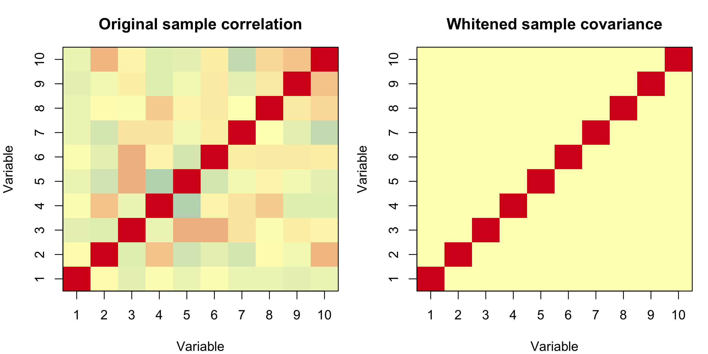
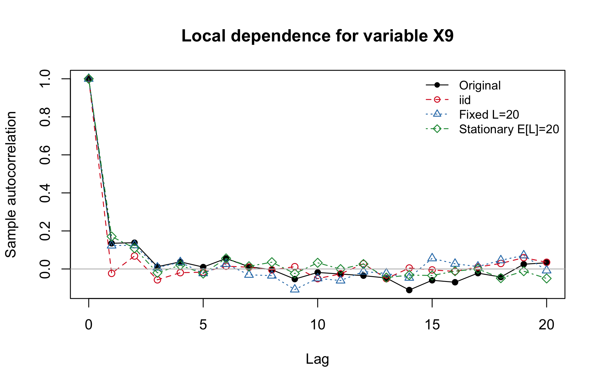
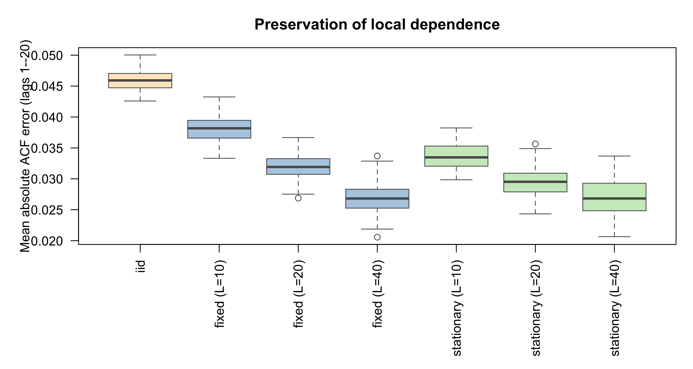
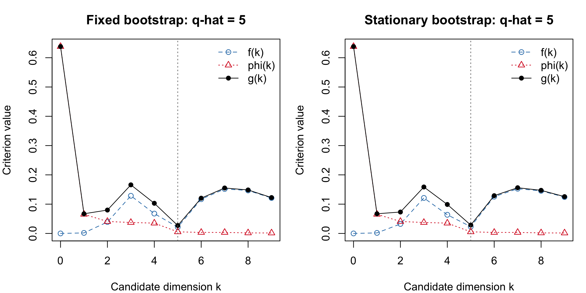

# Task 1: Time series bootstrap and the ladle estimator

## Part A: Whitening and autocovariance matrices

### Conventions and implementation

The observations are stored as the rows of an $n\times p$ matrix $X$. Each
variable is centred using its full-sample column mean,

$$
X_c=X-\mathbf{1}_n\bar{x}^{\mathsf T},
\qquad
S_0=\frac{1}{n-1}X_c^{\mathsf T}X_c.
$$

If $S_0=VDV^{\mathsf T}$, the symmetric whitening matrix and whitened data are

$$
W=S_0^{-1/2}=VD^{-1/2}V^{\mathsf T},
\qquad Y=X_cW.
$$

Eigenvalues below $10^{-10}$ times the largest eigenvalue are treated as
numerically zero because their inverse square roots would be unstable. No
additional marginal scaling is applied because scaling is already included in
$W$.

For lag $h\geq1$, we estimate

$$
\widehat C_h
=\frac{1}{n-h}\sum_{t=1}^{n-h}y_ty_{t+h}^{\mathsf T}.
$$

The mean is not re-estimated within each lag window. Row $t$ is paired with row
$t+h$, and normalization uses the $n-h$ available pairs. The matrices used for
joint diagonalization are symmetrized as
$\widehat C_h^{(s)}=(\widehat C_h+\widehat C_h^{\mathsf T})/2$.

### Purpose and numerical verification

Whitening removes contemporaneous scale and cross-covariance, so the lag-zero
sample covariance becomes $I_p$. In the second-order source-separation model,
this changes the unknown mixing matrix into an orthogonal matrix, allowing the
remaining directions to be estimated by orthogonal joint diagonalization.
Whitening does not make the observations serially independent; non-zero-lag
dependence remains in the autocovariance matrices and provides the information
used to identify the signal directions.

For the supplied data, $n=1000$ and $p=10$. The numerical checks gave

$$
\max_j|\bar y_j|=6.49\times10^{-14},\qquad
\max_{j,k}\left|\left\{\widehat{\operatorname{Cov}}(Y)-I_{10}\right\}_{jk}\right|
=3.55\times10^{-15}.
$$

The whitened variances ranged from $0.999999999999997$ to $1$, and the largest
absolute off-diagonal covariance was $2.58\times10^{-15}$. These values confirm
the expected whitening effect to numerical precision. The non-zero Frobenius
norms of the lagged matrices, including $0.3653$ at lag 1 and $0.5575$ at lag 2,
also show that whitening does not force non-zero-lag covariance estimates to
zero.

{#fig-task1-whitening width=88% fig-align="center"}

## Part B: Bootstrap for dependent observations

### Fixed-block bootstrap

For block length $L$, a starting position is sampled uniformly with replacement
from $\{1,\ldots,n-L+1\}$. The corresponding $L$ consecutive multivariate rows
are retained in their original order. This is repeated $\lceil n/L\rceil$
times, after which the blocks are concatenated and truncated to $n$ rows. The
tuning parameter $L$ determines how much local dependence can be retained
within each block.

### Stationary bootstrap

The stationary bootstrap begins at an index sampled uniformly from
$\{1,\ldots,n\}$. At every subsequent position, a new uniform index is selected
with probability $r=1/L$; otherwise, the previous index is advanced by one,
with circular wrap-around from $n$ to 1. Consequently, each block length $K$
has the geometric distribution

$$
\Pr(K=k)=r(1-r)^{k-1},\qquad E(K)=\frac{1}{r}=L.
$$

Unlike the fixed-block method, the stationary bootstrap uses random block
lengths. In 100 generated samples, target expected lengths 10, 20 and 40 gave
mean observed lengths 9.94, 20.20 and 40.94, respectively.

### Why IID resampling is unsuitable

Resampling individual rows independently destroys temporal ordering and makes
non-zero-lag autocovariances approximately zero. Such samples do not represent
the variability of statistics calculated from the original dependent process.
Both block procedures instead resample consecutive multivariate observations,
preserving local serial and cross-series dependence within blocks.

{#fig-task1-acf-comparison width=78% fig-align="center"}

### Effect of block length

Dependence preservation was evaluated using the mean absolute difference
between the original and bootstrap sample autocorrelations, averaged over all
10 variables and lags 1--20. Each row of @tbl-task1-acf-error summarizes 100
bootstrap samples.

| Method | Mean error | Standard deviation |
|:--|--:|--:|
| IID | 0.0460 | 0.0017 |
| Fixed, $L=10$ | 0.0381 | 0.0021 |
| Fixed, $L=20$ | 0.0320 | 0.0019 |
| Fixed, $L=40$ | 0.0270 | 0.0025 |
| Stationary, $E(K)=10$ | 0.0336 | 0.0020 |
| Stationary, $E(K)=20$ | 0.0295 | 0.0024 |
| Stationary, $E(K)=40$ | 0.0269 | 0.0027 |

: Mean absolute ACF error; smaller values indicate better local-dependence preservation. {#tbl-task1-acf-error}

IID resampling has the largest error. Longer blocks preserve the observed ACF
more closely, although they provide fewer effectively independent blocks and
slightly greater Monte Carlo variability. Block length is therefore a tuning
choice that balances dependence preservation against the number of resampled
blocks.

{#fig-task1-acf-error width=90% fig-align="center"}

## Part C: The ladle quantities

### Eigenvalue-based quantity $\phi$

For the lag set $\mathcal T$, an orthogonal matrix $U$ approximately jointly
diagonalizes the whitened autocovariance matrices. The component strengths are

$$
s_j=\sum_{h\in\mathcal T}
\left[
\operatorname{diag}\!\left(U^{\mathsf T}\widehat C_h^{(s)}U\right)_j
\right]^2,
$$

ordered so that $s_0\geq\cdots\geq s_{p-1}$. The normalized scree contribution
is

$$
\phi(k)=\frac{s_k}{1+\sum_{\ell=0}^{p-1}s_\ell},
\qquad k=0,\ldots,p-1.
$$

Large values correspond to directions with serial dependence, while noise
directions should have strengths close to zero. When several lags are used,
$U$ is obtained with `JADE::rjd`; the strength calculation and ordering are
implemented directly.

### Bootstrap-variability quantity $f$

Let $\widehat B_k$ and $B^*_{k,b}$ contain the first $k$ ordered directions
from the original sample and bootstrap sample $b$. Their subspace instability
is measured by

$$
f_0(k)=\frac{1}{B}\sum_{b=1}^{B}
\left\{1-\left|\det\!\left(\widehat B_k^{\mathsf T}B^*_{k,b}\right)\right|\right\},
\quad k=1,\ldots,p-1,
\qquad f_0(0)=0,
$$

and normalized as

$$
f(k)=\frac{f_0(k)}{1+\sum_{\ell=0}^{p-1}f_0(\ell)}.
$$

The absolute determinant measures agreement between the two $k$-dimensional
subspaces and is invariant to sign changes of individual directions. Stable
signal subspaces have small $f(k)$, while variability increases when noise
directions enter the estimated subspace.

### Combination and dimension estimate

The ladle criterion combines the two sources of information:

$$
g(k)=f(k)+\phi(k),\qquad
\widehat q=\underset{k\in\{0,\ldots,p-1\}}{\arg\min}\;g(k).
$$

The scree contribution decreases as weak or noise directions are included,
whereas the bootstrap contribution increases when the estimated subspace
becomes unstable. Their sum balances signal strength and subspace stability.

### Simulation check

The implementation was checked using Setting 1 of Nordhausen and Virta: five
Gaussian AR/MA signal series and five Gaussian white-noise series, giving
$p=10$ and true dimension $q=5$. The check used $n=1000$, lags 1--12, 100
bootstrap samples and block length 20. Both the fixed-block and stationary
bootstrap versions returned $\widehat q=5$.

The largest whitening identity error was $3.22\times10^{-15}$, the largest
orthogonality error in $U^{\mathsf T}U$ was $2.22\times10^{-15}$, and the joint
off-diagonal squared-energy ratio was $0.0718$. These checks verify the
whitening, orthogonal directions, approximate joint diagonalization and
recovery of the known signal dimension.

{#fig-task1-ladle width=92% fig-align="center"}

## Part D: Simulation study

## Part E: Application to the course data

# Task 2: Bayesian mixture modelling with MCMC

## Part A: Latent-variable representation and Gibbs sampler

## Part B: Simulation study and computational behaviour

## Part C: Label switching and identifiability

## Part D: Application to real data
