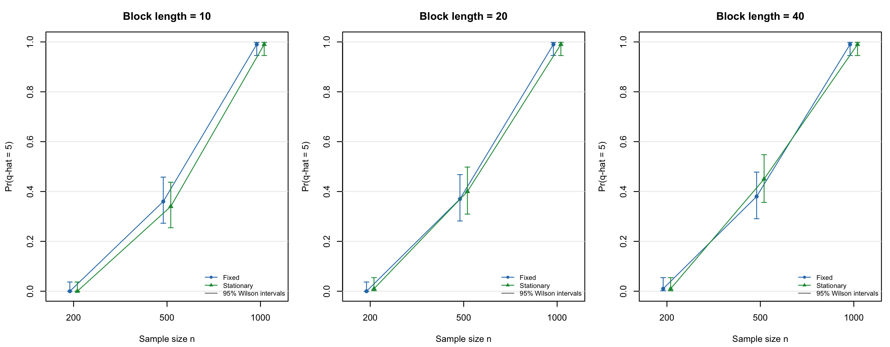
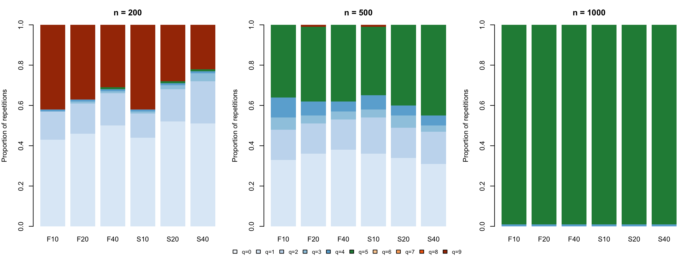
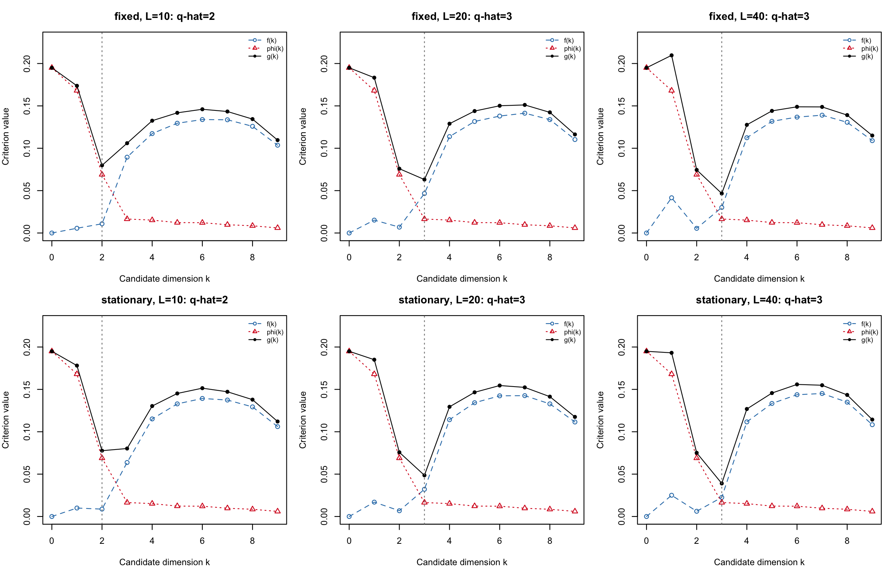
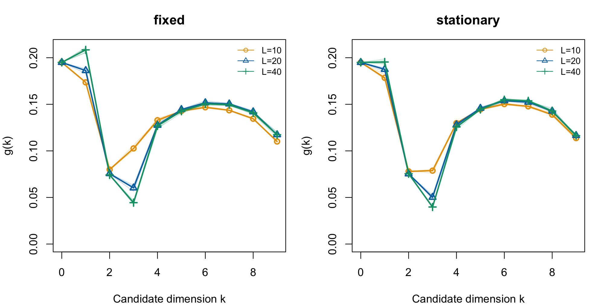

# Task 1: Time series bootstrap and the ladle estimator

## Part A: Whitening and autocovariance matrices

## Part B: Bootstrap for dependent observations

## Part C: The ladle quantities

## Part D: Simulation study

### Simulation setting and study design

The purpose of the simulation is to assess whether the implementation recovers a
known signal dimension, and how its performance changes with sample size,
bootstrap method and block length. We use Setting 1 of Nordhausen and Virta,
with $p=10$ components and true signal dimension $q=5$.
The model has identity mixing, $x_t=z_t$, where the first five components are
independent Gaussian AR/MA processes and the remaining five are independent
Gaussian white-noise series. The signal parameters are listed in
@tbl-de-processes, using the convention

$$
z_{j,t}=\sum_{\ell=1}^{r_j}a_{j,\ell}z_{j,t-\ell}
      +\varepsilon_{j,t}
      +\sum_{\ell=1}^{s_j}b_{j,\ell}\varepsilon_{j,t-\ell},
\qquad \varepsilon_{j,t}\overset{\mathrm{iid}}{\sim}N(0,1).
$$

Innovations are independent across components. The five noise series also have
independent $N(0,1)$ observations. As in the implementation used in Part C, each
generated column is centred and scaled to unit sample variance before the
whitening step.

| Component | AR coefficients | MA coefficients |
|:---------:|:----------------|:----------------|
| 1 | $(0.6)$ | $(0,-0.4)$ |
| 2 | $(0.4,0.1,0.3)$ | $(0.2,0.4)$ |
| 3 | $(0.4)$ | -- |
| 4 | -- | $(0.5,0.3,0.1,0.2)$ |
| 5 | $(0.1,0.1,0.3)$ | -- |

: Signal processes in Setting 1. A dash denotes an absent AR or MA part. {#tbl-de-processes}

We consider $n\in\{200,500,1000\}$, the SOBI lag set
$\mathcal T=\{1,\ldots,12\}$, and both fixed-block and stationary bootstrap
methods. For each method, $L\in\{10,20,40\}$ denotes the fixed or expected block
length, respectively. These choices match the corresponding settings in the
paper. This study focuses on SOBI, extending the implementation from Parts A--C;
it does not repeat the paper's separate AMUSE comparison.

For each sample size, $R=100$ independent datasets are generated. Each dataset is
analysed under all six method--length combinations, giving $1800$ ladle fits.
Each fit uses $B=100$ bootstrap samples. The paper uses $2000$ simulation
repetitions and $200$ bootstrap samples per fit; our smaller experiment is
intended to reproduce the main qualitative behaviour while keeping the
computational cost manageable. Here $R$ measures variation between independently
generated datasets, whereas $B$ controls the Monte Carlo approximation within a
single ladle fit.

### Computational procedure and tuning choices

For each generated dataset, the calculation proceeds as follows.

1. Centre the observations and whiten them using the symmetric inverse square
   root of the sample covariance matrix, following the conventions in Part A.
   Compute the symmetrized autocovariance matrices at lags $1,\ldots,12$.
2. Apply `JADE::rjd` to obtain the orthogonal joint diagonalizer. Order its
   directions by decreasing sums of squared diagonal autocovariances. These
   strengths determine the scree contribution $\phi(k)$ from Part C.
3. Generate $B$ multivariate bootstrap samples using either fixed blocks of
   length $L$ or stationary blocks with restart probability $1/L$, as in
   Politis and Romano. For every bootstrap sample, repeat centring, whitening,
   autocovariance estimation, joint diagonalization and ordering. Thus the
   bootstrap includes uncertainty in the preprocessing as well as in the
   estimated directions.
4. Use the determinant-based comparison of the original and bootstrap leading
   subspaces to compute $f(k)$. Form

   $$
   g(k)=f(k)+\phi(k),\qquad
   \widehat q=\mathop{\arg\min}_{k=0,\ldots,9}g(k),
   $$

   and record $\widehat q$.

Short blocks contain more boundaries and consequently break more lagged pairs.
In particular, a fixed block of length $10$ cannot preserve a lag-$12$ pair
within a single block. Larger blocks preserve longer stretches of dependence
but provide fewer independently resampled blocks; at $n=200$, $L=40$ gives only
five fixed blocks. The three lengths therefore explore a relevant trade-off
rather than assuming that the longest block must always be best.

Explicit seeds are assigned to the generated datasets and bootstrap fits.
Sharing each dataset across the six settings permits paired comparisons of the
methods, but these six fits are not six independent simulation repetitions.
The joint-diagonalization tolerance is $10^{-6}$. Its iteration limit is increased
from $1000$ to $10000$ because a few preliminary bootstrap calculations reached
the smaller limit; the tolerance is unchanged. All $1800$ final fits completed.
The maximum whitening identity error was $2.76\times10^{-14}$, and the maximum
direction-orthogonality error was $8.22\times10^{-15}$.

### Monte Carlo summaries and results

For a fixed sample size, method and block length, let
$I_r=\mathbf 1\{\widehat q_r=5\}$. The estimated correct-selection probability
and its Monte Carlo standard error are

$$
\widehat P=\frac{1}{R}\sum_{r=1}^{R}I_r,
\qquad
\widehat{\operatorname{MCSE}}(\widehat P)
=\sqrt{\frac{\widehat P(1-\widehat P)}{R}}.
$$

With $R=100$, the largest possible MCSE is $0.05$. We also report $95\%$ Wilson
intervals, which remain informative when the observed success rate is $0$ or $1$.
The complete dimension distribution distinguishes underestimation from
overestimation instead of reducing performance to the mean estimated dimension.

| Method | $L$ | $n=200$ | $n=500$ | $n=1000$ |
|:-------|----:|--------:|--------:|---------:|
| Fixed | 10 | 0 | 36 | 99 |
| Fixed | 20 | 0 | 37 | 99 |
| Fixed | 40 | 1 | 38 | 99 |
| Stationary | 10 | 0 | 34 | 99 |
| Stationary | 20 | 1 | 40 | 99 |
| Stationary | 40 | 1 | 45 | 99 |

: Percentage of repetitions selecting the true dimension $q=5$. Each entry is based on $100$ independent datasets and $B=100$ bootstrap samples per fit. {#tbl-de-recovery}

@tbl-de-recovery and @fig-de-recovery show that sample size has the
clearest effect. At $n=200$, correct selection occurs in only $0$--$1\%$ of
repetitions. Both underestimation and overestimation are common: their rates
range from $58$--$77\%$ and $22$--$42\%$, respectively. At $n=500$, recovery
improves to $34$--$45\%$, with most remaining errors being underestimates. At
$n=1000$, every setting selects $q=5$ in $99$ repetitions and $q=4$ in one. The
corresponding $95\%$ Wilson interval for the recovery rate is
$[94.6\%,99.8\%]$, so the experiment shows high but not perfectly known
population performance.

{#fig-de-recovery width=100%}

The difference between bootstrap methods is smaller than the sample-size effect.
For example, at $n=500$ the stationary-minus-fixed differences in recovery are
$-2$, $3$ and $7$ percentage points for $L=10,20,40$, with paired MCSEs of
$3.48$, $3.32$ and $3.83$ percentage points. These standard errors are computed
from the within-dataset differences $I_{r,S}-I_{r,F}$, accounting for the shared
datasets. The modest advantage of longer stationary blocks at $n=500$ should
therefore not be treated as decisive evidence that one method is universally
superior. The methods give identical dimension selections in this experiment
at $n=1000$.

{#fig-de-distribution width=95%}

The broad distributions for the shorter series in @fig-de-distribution
demonstrate that their poor recovery is not merely a small bias around $q=5$.
In contrast, the long-series distributions concentrate at the true dimension.
This reproduces the main qualitative finding of Nordhausen and Virta:
SOBI-based ladle estimation becomes reliable when the series are sufficiently
long, while short series can be inadequate. Our results provide numerical
validation under Setting 1, rather than a proof of consistency or a precise
replication of every result in the paper. They also describe the estimator at
the finite bootstrap budget $B=100$.

## Part E: Application to the course data

### Application procedure and block-length selection

The supplied `timeseries.dat` contains $n=1000$ observations of $p=10$
variables. We apply the same whitening, lag set $\mathcal T=\{1,\ldots,12\}$,
joint diagonalization and ladle calculations used in Part D. Both bootstrap
methods are fitted at $L=10,20,40$. The primary choice is $L=20$, carried forward
from Parts B--C: it permits within-block pairs at every selected lag while
retaining approximately $50$ fixed blocks. Lengths $10$ and $40$ assess how the
conclusion changes when less or more temporal dependence is preserved.

Because this application involves only one observed dataset, we increase the
bootstrap budget to $B=500$ and repeat each method--length setting with five
independent bootstrap seeds. These $30$ fits assess Monte Carlo stability
conditional on the same observations; they do not constitute $30$ independent
datasets or provide a sampling confidence interval for the true dimension. For
each fit, we examine the full curves $f$, $\phi$ and $g$, the selected dimension,
and the gap between the smallest and second-smallest values of $g$.

### Estimated dimension and supporting evidence

| Method | $L$ | Observed $\widehat q$ | Selection counts | Minimum gap |
|:-------|----:|:----------------------:|:-----------------|------------:|
| Fixed | 10 | 2 | $2$: 5 runs | 0.02019 |
| Stationary | 10 | 2 or 3 | $2$: 4; $3$: 1 | 0.00069 |
| Fixed | 20 | 3 | $3$: 5 runs | 0.01278 |
| Stationary | 20 | 3 | $3$: 5 runs | 0.02273 |
| Fixed | 40 | 3 | $3$: 5 runs | 0.02783 |
| Stationary | 40 | 3 | $3$: 5 runs | 0.03459 |

: Dimension estimates across five bootstrap seeds, with $B=500$ per fit. The last column is the smallest gap between the two lowest criterion values across those five runs. {#tbl-de-application}

Both methods consistently select $\widehat q=3$ at $L=20$ and $L=40$
(@tbl-de-application). For the primary fixed-block fit with $L=20$ and the
first seed,

$$
f(3)=0.04660,\qquad \phi(3)=0.01649,\qquad g(3)=0.06310.
$$

The next-best candidate is $k=2$, whose criterion is larger by $0.01278$. The
first four ordered component strengths are approximately $0.39989$, $0.34474$,
$0.14143$ and $0.03383$. The drop after the third direction supports a
three-dimensional signal subspace, while the bootstrap component penalizes the
instability introduced by additional weak directions.

{#fig-de-components width=100%}

@fig-de-components shows how the two contributions determine the minimum.
The scree contribution is shared by the bootstrap settings because it depends on
the original sample, whereas $f$ changes with the resampling method and block
length. At $L=20$ and $40$, the combination has its minimum at $3$ for both
methods. However, the results are not uniform over all block lengths: fixed
blocks of length $10$ select $2$ in every run, and stationary blocks with
expected length $10$ select $2$ in four runs and $3$ in one. The particularly
small gap for the latter setting indicates that the two candidates are close; it
is not a hypothesis-test $p$-value or a confidence level.

### Investigating block-length sensitivity

{#fig-de-sensitivity width=100%}

@fig-de-sensitivity shows that the main discrepancy concerns the
competition between $k=2$ and $k=3$. To investigate it, we examine the ordered
components obtained from the original-data decomposition,

$$
\widehat Z=(X-\mathbf 1_n\bar x^{\mathsf T})\widehat W\widehat U.
$$

The third component has its largest absolute sample autocorrelation over lags
$1$--$12$ at lag $h=8$, where its value is approximately $0.287$. This relatively
long-lag feature is especially vulnerable to short blocks.

For fixed blocks, the approximate fraction of lag-$h$ pairs lying within one
block is $\max(1-h/L,0)$, ignoring finite-series end effects. For stationary
blocks, the probability of no restart over $h$ steps is $(1-1/L)^h$. At $h=8$,
these quantities are

$$
\begin{array}{c|ccc}
L & 10 & 20 & 40 \\ \hline
\text{Fixed: within-block fraction} & 0.200 & 0.600 & 0.800 \\
\text{Stationary: no-restart probability} & 0.430 & 0.663 & 0.817
\end{array}
$$

They describe preservation of local ordering, not exact autocorrelation
attenuation factors or dimension-recovery probabilities. Nevertheless, they
provide a plausible explanation for the observed sensitivity: short blocks
weaken the dependence supporting the third direction, increasing the bootstrap
instability of the three-dimensional subspace. Increasing $L$ makes the minimum
at $k=3$ clearer. The agreement at $L=20$ and $40$, together with this dependence
pattern, supports reporting $\widehat q=3$ as the main conclusion while
explicitly retaining the short-block alternative.

{#fig-de-acf width=100%}

### Interpretation and limitations

Under the second-order source-separation model, the main result suggests three
serially dependent linear combinations of the ten observed variables and seven
remaining directions with weaker dependence at the selected lags. The first
three component ACFs have pronounced features at lags $2$, $5$ and $8$,
respectively (@fig-de-acf). The remaining component strengths are smaller,
although their sample ACFs are not identically zero.

The estimated dimension counts latent linear combinations, not a subset of
three original variables. Nor does the classification establish that the
remaining directions are independent, Gaussian, or free of nonlinear
dependence. The interpretation is conditional on approximate stationarity, the
SOS model and the selected lag set. Finally, successful recovery in Setting 1
validates the computational procedure under that design; it does not establish
the unknown dimension of this particular dataset. Here the evidence for three
directions comes from the criterion curves, the longer-block agreement and the
observed dependence structure, with the sensitivity at $L=10$ reported as part
of the result.

# Task 2: Bayesian mixture modelling with MCMC

## Part A: Latent-variable representation and Gibbs sampler

## Part B: Simulation study and computational behaviour

## Part C: Label switching and identifiability

## Part D: Application to real data
